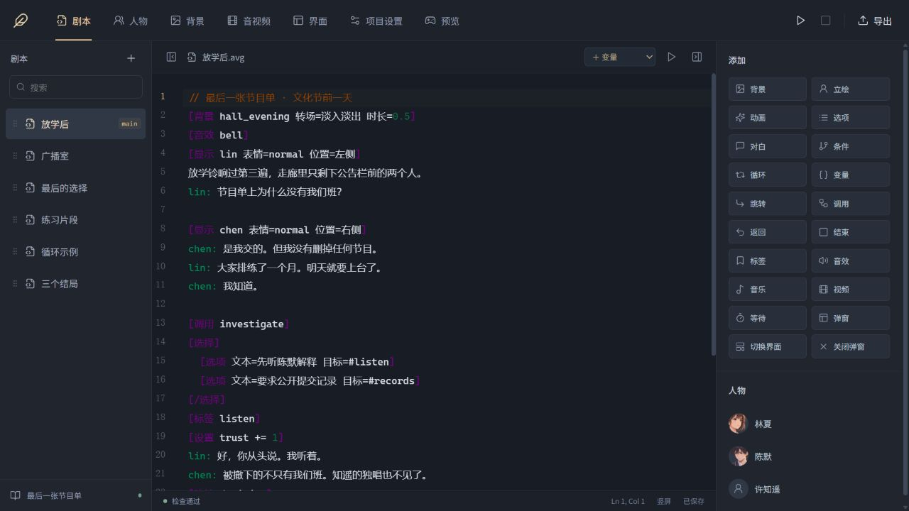

# 豆剧场

与 AI Agent 一起创作文字冒险（AVG）和轻养成游戏。通过 Skill 让豆包工作、Codex 等 Agent 建立项目，再用可视化编辑器直接调整作品。用不用 AI 随你，整个工程都属于你。

[项目介绍与文档](https://wangyu.tech/avg/) · [下载 Skill](https://wangyu.tech/avg/skill.zip) · [MIT License](LICENSE)



## 功能

- 中文剧本与标识符，支持对白、分支、变量、条件、循环和脚本调用。
- 人物、半身立绘、背景、音视频及界面的可视化编辑。
- Cocos 游戏预览、打字机效果、对话历史和变量调试。
- 导出 Web、微信与抖音小游戏，或 Cocos Creator 工程。
- 内置校园短篇《最后一张节目单》，项目由普通文本配置和素材组成。

## 使用 Skill

告诉豆包工作或其他支持 Skill 的 Agent：

```text
安装 wangyu.tech/avg/skill.zip 并打开编辑器。
```

技能包已带编译好的编辑器、服务和引擎，需要 Node.js 22+，无需安装 npm 依赖或 Cocos Creator。

## 从源码运行

需要 Node.js 22+：

```sh
npm ci
node scripts/cli.mjs init --project projects/my-story --language zh
node scripts/cli.mjs serve --dev --project projects/my-story --port 5173
```

打开终端输出的本机地址即可编辑自己的项目。也可运行 `npm run dev` 查看内置示例。仓库保留预构建 Web 和小游戏引擎，日常运行与修改编辑器无需 Creator。

```sh
npm test
npm run build
npm run product:build
npm run product:verify
```

`product/` 是生成的发布目录，不提交到 Git；其中包含 `skill.zip`、`source.zip`、`kit-minigames.zip`、介绍页和文档。源码包、技能包与小游戏包会保留许可证文件。

若修改游戏运行时（`src/core` 或 `cocos-template/AvgPlayer.ts`），使用 Cocos Creator 3.8.8 重新构建预编译引擎：

```sh
npm run engine:build
npm run minigames:build
npm run product:build
npm run minigames:test
npm run distribution:test
```

## 目录与文档

| 目录 | 内容 |
| --- | --- |
| `src/` | 编辑器及剧本运行时 |
| `cocos-template/` | Cocos 游戏播放器源码 |
| `public/engine/` | 预构建 Web 引擎 |
| `kits/minigames/` | 小游戏导出工具和预构建播放器 |
| `skills/avg-maker/` | Skill 入口及参考文档 |
| `projects/last-program/` | 内置示例 |
| `website/`、`docs/` | 介绍页、图文指南和技术参考 |

[快速入门](docs/getting-started.md) · [撰写剧本](docs/writing-story.md) · [项目结构](docs/project-format.md) · [脚本格式](docs/script-system.md) · [构建与分发](docs/runtime-distribution.md)

## 许可证

原创代码及随附示例采用 [MIT License](LICENSE)。第三方依赖和 Cocos 引擎保留各自的版权声明，见 [第三方说明](THIRD_PARTY_NOTICES.md)。
